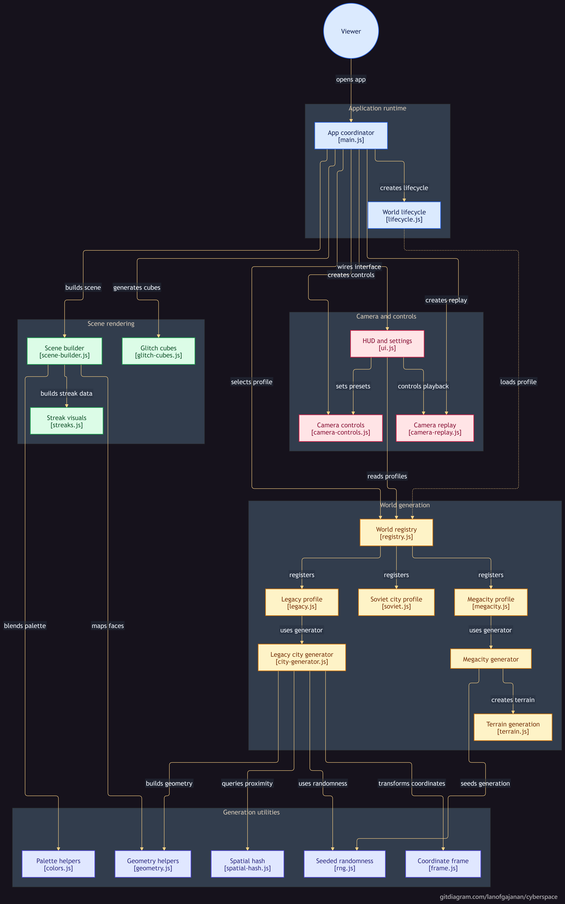

# Net / Cyberspace — City.OS

A procedurally generated 3D city visualizer inspired by the **Net / Cyberspace sequences from *Cyberpunk 2077***.

The scene uses a monochrome **solid-geometry + glowing-edge** vector aesthetic. Roads grow organically outward from a rotated downtown grid or follow rigid monumental axes, buildings orient toward the streets they front, and visual density transitions from towering stepped monoliths to low-profile structures at the rim.

The project is built around procedural generation, deterministic world states, custom camera controls, single-draw-call rendering, and an explicit scene lifecycle.

---

## Preview


---

## Running Locally

This project uses native ES modules (`import` / `export`), which browsers refuse to load over the `file://` protocol for security reasons — a local HTTP server is required.

### Using `npx`
```bash
npx serve .
```

### Using Python
```bash
python3 -m http.server
```

Then open the `localhost` URL printed in the terminal.

> **Important:** Opening `index.html` directly by double-clicking it will **not work**; browser CORS rules will block ES module imports.

### Zero-Build Deployment
There is no bundler, no `npm install`, and nothing to compile. The only external runtime dependency is **Three.js**, loaded directly through the browser import map in `index.html` from a CDN. The project can be deployed immediately to GitHub Pages or any static host.

---

## World Profiles

Cyberspace features three distinct procedural city architectures:

### 1. Legacy City (`legacy`)
- **Character:** Organic, grown, emergent.
- **Layout:** Roads grow outward from a rotated downtown grid using wandering streamlines; buildings orient to whichever street they front; density tapers from tall stepped towers downtown to mid-rise slabs and houses near the edges.
- **Non-overlap:** Spatial hash reservations for parks and hospitals, growth-time collision detection, and radial rejection sampling for frontage lots.

### 2. Megacity — Vertical Slice (`megacity`)
- **Character:** High-density terraced center.
- **Layout:** Six terraced elevation shelves, the authored City Center, animated traffic flow lines, and the red-edged Blackwall containment perimeter.
- **Diagnostics:** Seeded terrain state, chunk readiness, and slope analysis.

### 3. Soviet Brutalist City (`soviet`)
- **Character:** Monumental, axial, rigid, perfectly symmetric.
- **Layout:** Authored coordinate tables with zero randomness. A monumental central axis features the stepped House of Soviets monolith, Red Star obelisks, central civic square, 6-lane prospekt, river bridge, and monument roundabout with a colossal statue and colonnade. Flanked by 8 showpiece towers, residential microraion superblocks, an industrial belt with wireframe cooling towers, and a fenced perimeter ring road with watchtowers.
- **Palette:** Cold pale grey edges and window matrices with signature crimson red accents on civic monuments, spires, and chimney bands.

---

## Cities Architecture & Adding New Cities

The codebase features a modular, plug-and-play **Cities Subsystem** in `js/cities/`.

Adding a new city requires **zero edits to HTML, CSS, or UI code**:

```
Step 1: Copy `js/cities/template.js` -> `js/cities/<your-city>.js`
Step 2: Implement your generation function returning the standard CityData contract.
Step 3: Register it in `js/cities/registry.js` (add 1 import + add to `CITIES`).
Step 4: Validate in terminal:
          node js/cities/validate.js <your-city-id>
```

The engine automatically:
- Generates the segmented control button in the UI tool rail.
- Adds an option to the mode select dropdown.
- Sets up the World Card badge, kicker, description, seed, and block counts.
- Applies custom per-world color palettes (edges, windows, accents, ground, centerlines).
- Manages GPU object lifecycle and memory cleanup on world switching.

### Automated CLI Validation Suite

Any city's math, vertex buffers, and collision bounds can be tested in Node without opening a browser:

```bash
# Test a specific city:
node js/cities/validate.js soviet
node js/cities/validate.js legacy
node js/cities/validate.js megacity

# Test all registered cities:
node js/cities/validate.js all
```

The validator checks:
1. **Execution**: Verifies the generator completes without errors.
2. **Buffer Integrity**: Confirms all vertex arrays are divisible by 6 (`length % 6 === 0`) and contain only finite floats.
3. **Bounding Extent**: Checks that all solid corners fall within `CITY_RADIUS`.
4. **Collision Detection**: Performs 3D AABB overlap tests across all axis-aligned solids.

---

## Architecture & Data Flow

The project strictly separates **world generation** from **rendering**:

> **Generation produces data. Rendering consumes data.**



### Generation Pipeline
```text
Seed / Layout Tables
        │
        ▼
Coordinate Frame (frame.js)
        │
        ▼
Road Network & Arterials
        │
        ├──► Spatial Hash (spatial-hash.js)
        │
        ▼
Superblocks & Lots
        │
        ├──► Road Orientation
        └──► Reserved Sites (civic core, parks, hospitals)
        │
        ▼
Plain Generated Data Contract
        │
        ▼
Three.js Scene Construction (scene-builder.js)
```

Generators return plain JavaScript arrays of numbers (`buildingBoxes`, `edgeVerts`, `windowVerts`, `accentVerts`, `groundVerts`, `centerlineVerts`). Only `scene-builder.js` creates Three.js meshes and line segments.

---

## File Structure

```text
index.html                  Markup, layout, styles link, import map, loads js/main.js
css/style.css                All styling (responsive HUD, tool rail, inspector, world card)
js/
  cities/                    Pluggable Cities Subsystem
    registry.js              Central registry of all cities (drives menus & lifecycles)
    template.js              Starter boilerplate template for new cities
    validate.js              Node CLI test suite (vertex integrity, bounds, collisions)
    legacy.js                Legacy organic city generator & profile
    megacity.js              Megacity vertical slice generator & profile
    soviet.js                Soviet brutalist axial generator & profile
  geometry.js                Line segment pushers, box corners, face-local points
  frame.js                   Local coordinate frame translation & rotation
  rng.js                     Seeded pseudo-random number generator
  spatial-hash.js            2D spatial hash for proximity and clearance queries
  colors.js                  Color constants, palette definitions, alpha-compositing blend
  scene-builder.js           GPU scene constructor (instanced meshes, merged line batches)
  glitch-cubes.js            Extruding facade voxel packets
  streaks.js                 Converts line/fill data into cyberpunk matrix dot streaks
  camera-controls.js         Hand-rolled orbit, pan, and first-person fly camera controls
  camera-replay.js           Waypoint capture, quaternion slerp, and route playback
  ui.js                      Dynamic inspector tabs, segmented controls, telemetry, and HUD
  main.js                    Entry point, loop, telemetry, and staged loading coordinator
  lifecycle.js               Explicit init/update/dispose mode shell
  SKILL.md                   Comprehensive architecture and engineering guide for devs & AI
```

---

## World Lifecycle

All world profiles implement a unified lifecycle:

```javascript
init(ctx)
update(dt)
dispose()
```

Switching profiles explicitly disposes of geometries, instanced matrices, and materials rather than simply replacing scene references, preventing GPU memory leaks across re-generations.

---

## Rendering & Performance

- **One Instanced Mesh for all solids:** All building boxes render as a single `THREE.InstancedMesh` (one draw call for the entire city, regardless of building count).
- **Baked Vertex Alpha Compositing:** Edge, window, accent, ground, and centerline layers are merged into a single `THREE.LineSegments` draw call. Layer alpha blending is precomputed once at build time into vertex colors (`blendedColor(hex, alpha)`), avoiding per-frame GPU blending passes.
- **Draw Call Efficiency:** Total draw calls typically stay between 2 and 4, ensuring smooth 60 FPS performance on lower-end devices.

---

## Camera Navigation & Replay

### Camera Controls
- **Orbit Mode:** Left-click drag to rotate · Right-click or Middle-click drag to pan · Scroll wheel to zoom · W/A/S/D to pan.
- **Fly Mode:** Click canvas to lock mouse · Mouse look to steer · W/S/A/D to move · Space for up · Ctrl for down · Shift to sprint · Esc to exit cursor lock.
- **Interface:** Press `Tab` to toggle HUD on/off · Press `H` to toggle the navigation help modal.

### Camera Replay System
- Capture waypoints along camera routes.
- Path positions interpolate with **per-segment Hermite timing**, while orientations interpolate with **quaternion slerp**.
- Supports route export/import as validated JSON.

---

## Current Status & Roadmap

- [x] Organic legacy city generator with rotated downtown grid
- [x] Terraced Megacity vertical slice with Blackwall perimeter
- [x] Authored Soviet Brutalist city generator with custom palette
- [x] Modular `js/cities/` architecture with dynamic menu generation
- [x] Standalone Node CLI validation test suite (`validate.js`)
- [x] Camera waypoint recording and replay timeline
- [ ] Post-processing bloom pass (`EffectComposer` + `UnrealBloomPass`)
- [ ] Additional city architectures and road hierarchy phases

---

## License

MIT
